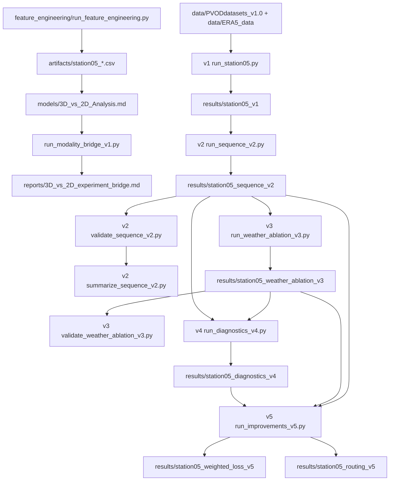

# station05 实验流程总览与一键运行顺序

这份文档只讲大方向，帮助快速理解本仓库实验链路，并按固定顺序复现关键结果。

## 1) 你需要知道的主线

- 更上游先是 `feature_engineering/run_feature_engineering.py`：它把 notebook 时代的下载 / 合并 / 特征分析收敛成一个可执行入口，先把统一特征表和报告产出出来。
- 其后是可选但很有价值的“模态桥接”步骤：`run_modality_bridge_v1.py`。它把 `models/` 里的 3D vs 2D 对标，标准化为 report 和 manifest，作为 experiments 的软门控建议，而不是硬阻断。
- 主实验链是：v1 基线对齐与首轮预测 -> v2 时序网络滚动评估 -> v3 天气消融 -> v4 一致性与场景诊断 -> v5 加权训练与条件路由。
- 输入维度上：v1 主要是表格型基线；v2/v3/v5 是 16 步历史序列，模型输入本质上是 3D 张量 `[samples, time_steps, features]`。
- 每个阶段输出到独立结果目录或报告产物，避免互相覆盖：
  - `results/station05_feature_engineering/station05_merged_2019-04.csv`
  - `reports/station05_feature_analysis_report_2019-04.md`
  - `station05_v1`
  - `reports/3D_vs_2D_experiment_bridge.md`
  - `station05_sequence_v2`
  - `station05_weather_ablation_v3`
  - `station05_diagnostics_v4`
  - `station05_weighted_loss_v5`
  - `station05_routing_v5`

## 2) 一张图看全流程



## 3) 一键运行顺序（从零复现）

在仓库根目录执行：

```bash
python3 -m venv .venv-pv
source .venv-pv/bin/activate
pip install -r PV_Prediction/PVOD_Forecast/experiments/requirements_sequence.txt

export OMP_NUM_THREADS=2
export OPENBLAS_NUM_THREADS=2

python PV_Prediction/PVOD_Forecast/experiments/run_modality_bridge_v1.py

python PV_Prediction/PVOD_Forecast/experiments/run_station05.py
python PV_Prediction/PVOD_Forecast/experiments/run_sequence_v2.py
python PV_Prediction/PVOD_Forecast/experiments/validate_sequence_v2.py
python PV_Prediction/PVOD_Forecast/experiments/summarize_sequence_v2.py

python PV_Prediction/PVOD_Forecast/experiments/run_weather_ablation_v3.py
python PV_Prediction/PVOD_Forecast/experiments/validate_weather_ablation_v3.py

python PV_Prediction/PVOD_Forecast/experiments/run_diagnostics_v4.py

python PV_Prediction/PVOD_Forecast/experiments/run_improvements_v5.py
```

说明：

- `run_improvements_v5.py` 已包含：`run_weighted_loss_v5.py -> run_routing_v5.py -> validate_improvements_v5.py -> summarize_improvements_v5.py`。
- 同名结果目录会被新一轮运行覆盖；如需并行保存，请先复制目录或改脚本中的 `OUT`。

## 4) 每一步输入/输出（大方向）

| 阶段 | 主脚本 | 主要输入 | 主要输出 |
|---|---|---|---|
| feature_engineering | `run_feature_engineering.py` | `data/PVODdatasets_v1.0/station05.csv`，或可选 raw inputs | `results/station05_feature_engineering/station05_merged_2019-04.csv`，`station05_cleaned_2019-04.csv`，`station05_engineered_2019-04.csv`，`station05_feature_analysis_report_2019-04.md`，`reports/feature_engineering_pipeline_bridge.md` |
| bridge | `run_modality_bridge_v1.py` | `models/3D_vs_2D_Analysis.md`，`models/station05.csv` | `reports/3D_vs_2D_experiment_bridge.md`，`reports/3D_vs_2D_experiment_bridge.json` |
| v1 | `run_station05.py` | `data/PVODdatasets_v1.0/station05.csv`，`data/PVODdatasets_v1.0/metadata.csv`，`data/ERA5_data/*.nc` | `results/station05_v1/station05_aligned_15min.csv`，`era5_station05_hourly.csv`，`metrics.csv`，`predictions_15min.csv`，`predictions_60min.csv` |
| v2 | `run_sequence_v2.py` | `results/station05_v1/station05_aligned_15min.csv` + 原始源文件哈希检查 | `results/station05_sequence_v2/*_predictions.csv`，`metrics.csv`，`seed_summary.csv`，`checkpoints.csv`，模型权重/Scaler |
| v2 检查 | `validate_sequence_v2.py`，`summarize_sequence_v2.py` | v2 预测、切分、模型文件 | `validation_checks.json`，汇总图表与文本输出 |
| v3 | `run_weather_ablation_v3.py` | v1 对齐表 + v2 配置/哈希 | `results/station05_weather_ablation_v3/*_predictions.csv`，`metrics.csv`，`seed_summary.csv`，`paired_deltas.csv` |
| v3 检查 | `validate_weather_ablation_v3.py` | v3 结果 | v3 校验输出与一致性检查 |
| v4 | `run_diagnostics_v4.py` | v1 对齐表 + v2 预测 + v3 预测/切分 | `results/station05_diagnostics_v4/weather_agreement.csv`，`training_scene_thresholds.csv`，`scene_metrics.csv`，`scene_seed_summary.csv` |
| v5 | `run_improvements_v5.py` | v1/v2/v3/v4 产物与哈希 | `results/station05_weighted_loss_v5/*`，`results/station05_routing_v5/*`（含选择结果、路由指标、图表、推理示例） |

## 5) 常用快速模式

- 只重画 v5 图表与证据表：

```bash
python PV_Prediction/PVOD_Forecast/experiments/summarize_improvements_v5.py
```

- 只重跑 v4 诊断（不重训）：

```bash
python PV_Prediction/PVOD_Forecast/experiments/run_diagnostics_v4.py
```

- 使用保存的 v5 路由模型做离线推理：

```bash
python PV_Prediction/PVOD_Forecast/experiments/predict_routing_v5.py --help
```

## 6) 结果解读边界（高层）

- v1 是表格型基线，不是序列 3D 模型。
- v2/v3/v5 使用的是 16 步历史序列，所以输入张量是 3D，但这和“3D 数据集”不是一回事。
- 当前结果主要是“历史回顾性实验”，并未完整模拟 ERA5 实时发布延迟。
- 单站点与已查看历史区间的结论，不能直接等价外部站点或新季节泛化能力。
- v5 的路由和加权属于同协议下的局部优化，应和独立新时段测试一起看。
