# 光伏预测项目架构

光伏预测是项目的主要研究主线，包含 DKASC、ERA5 和 PVOD 三类数据工作。DKASC 用于开展站点级光伏与天气关系分析；ERA5 用于天气一致性分析及多层气象特征研究；PVOD Station 05 是核心预测实验对象。整体流程从数据检查与特征分析开始，逐步推进至不同气象输入维度的比较、滚动预测验证和误差诊断。

## 架构图

```mermaid
flowchart LR
    subgraph CONTEXT[Weather Context]
        direction TB
        DKASC[DKASC PV and Weather Data] --> DKASC_ANALYSIS[Quality Checks and Feature Analysis]
        ERA5[ERA5 Historical Weather Data]
        DKASC --> WEATHER_CHECK[ERA5–DKASC Weather Consistency Analysis]
        ERA5 --> WEATHER_CHECK
    end

    subgraph INPUTS[PVOD Inputs]
        direction TB
        LOCAL[PVOD PV Power, NWP, and LMD Data]
        SURFACE[ERA5 Surface Fields<br/>2D: Time × Latitude × Longitude]
        PRESSURE[ERA5 Pressure-Level Fields<br/>3D: Time × Level × Latitude × Longitude]
        ALIGN[Time Alignment, Quality Checks, and Feature Table]
        LOCAL --> ALIGN
        SURFACE --> ALIGN
        PRESSURE --> ALIGN
    end

    subgraph ANALYSIS[Feature and Dimension Analysis]
        direction TB
        FEATURES[Feature Analysis<br/>Pearson, Mutual Information, and SHAP]
        DIM_COMPARE[2D vs 3D Model Comparison]
        FEATURES --> DIM_COMPARE
    end

    subgraph EXPERIMENTS[Forecasting Experiments]
        direction TB
        BASELINES[Forecasting Baselines<br/>Persistence, Ridge, Tree Models, and MLP]
        SEQUENCE[Sequence Models<br/>LSTM and GRU; 15- and 60-Minute Horizons]
        ABLATION[Weather Ablation<br/>Local, Surface, and Pressure-Level Inputs]
        BASELINES --> SEQUENCE
        SEQUENCE --> ABLATION
    end

    subgraph EVALUATION[Evaluation and Outputs]
        direction TB
        DIAGNOSTICS[Rolling Evaluation and Scene Diagnostics]
        IMPROVEMENTS[Exploratory Weighted Loss and Classifier Routing]
        RESULTS[Metrics, Predictions, Models, and Reports]
        DIAGNOSTICS --> IMPROVEMENTS --> RESULTS
    end

    ALIGN --> FEATURES
    DIM_COMPARE --> BASELINES
    DIM_COMPARE --> ABLATION
    ABLATION --> DIAGNOSTICS
    BASELINES --> RESULTS
    SEQUENCE --> RESULTS
    WEATHER_CHECK -. Weather comparison, not forecast validation .-> RESULTS
    RESULTS --> FINAL[Final Report and Presentation]
    RESULTS -.-> LIMIT[Interpretation Limit<br/>ERA5 valid-time inputs are retrospective<br/>and do not establish real-time availability.]
```

## 研究流程说明

1. **DKASC 分析：** 检查 Alice Springs 光伏与站点天气数据，分析变量关系、特征贡献和初步模型表现。
2. **ERA5 分析：** 对比 ERA5 与 DKASC 站点天气数据，了解再分析数据与地面观测之间的一致性。该分析不等同于光伏预测增益验证。
3. **PVOD 特征与维度分析：** 以 Station 05 为主，进行特征评估，并比较 ERA5 地表特征和气压层特征，以及 2D 与 3D 输入方案。
4. **预测实验：** 先建立基线，再比较 LSTM/GRU 和不同天气输入组合，通过滚动时间区间、预测时长和场景误差评估结果。
5. **结果归档：** 保存指标、预测、切分、模型和实验报告，汇总至最终报告与展示材料。

## 结论适用范围

PVOD 预测实验以单站点和有限历史时段为主。ERA5 使用 valid-time 历史再分析字段，因此实验属于回顾性评估，不能单独证明实际运行时能够取得相同输入或达到相同效果。DKASC 与 ERA5 的天气一致性分析也不能替代 PV 预测性能评估。
