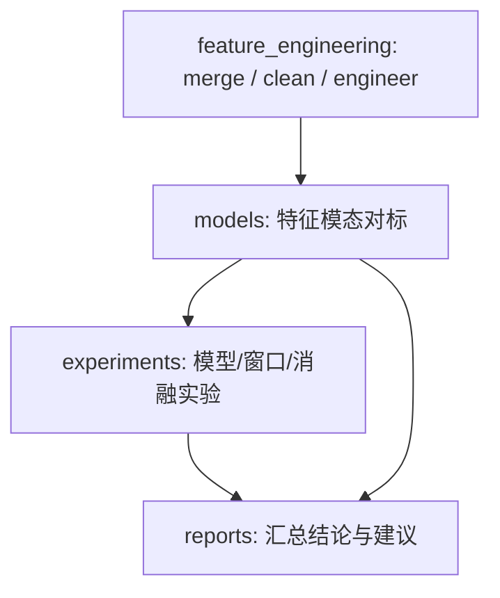

# 3D vs 2D 特征空间桥接报告

这个报告把 [models/3D_vs_2D_Analysis.md](PVOD_Forecast/reports/3D_vs_2D_Analysis.md) 里的探索性结论，标准化为一个可以被 experiments 消费的上游决策步骤。

更完整地说，它位于 `feature_engineering/` 之后、`experiments/` 之前：先由 feature_engineering 把数据整理成统一特征表，再由 models 目录判断是否值得把更高维 / 更高频模态作为默认输入。

## 结论先行

- 这里的 3D vs 2D 分析不是和 experiments 重复做同一件事，而是在做“输入模态选择”的上游判断。
- 如果 3D 数据的时间分辨率更粗、样本更少、且对短时光伏预测没有稳定增益，那么它不应成为默认主分支。
- 更合理的做法是：先用 feature_engineering 产出统一特征表，再用 models 目录完成模态可行性判断，最后在 experiments 目录验证模型收益并统一输出 report。

## 证据摘要

### 原报告中的性能对比

| 指标 | 2D 模型 | 3D 模型 | 变化 |
|---|---:|---:|---:|
| MAE | 0.9414 | 2.4695 | +162.3% |
| RMSE | 1.9012 | 4.1562 | +118.6% |
| R² | 0.9657 | 0.7636 | -0.202 (-21%) |

### 当前站点输入概况

- 时间范围: 2019-03-04 16:00:00 -> 2019-06-13 15:45:00
- 行数: 9696
- 特征数: 14
- 特征分组: NWP=7，LMD=6
- power 统计: min=0.0000，max=35.1181，mean=7.0556

### 与 power 相关性最高的特征

- lmd_totalirrad: 0.9909
- nwp_globalirrad: 0.9369
- nwp_directirrad: 0.9334
- lmd_diffuseirrad: 0.7600
- nwp_humidity: -0.4094

## 如何并入 experiments

推荐的闭环是：

1. 在 `feature_engineering/` 里先把原始表整理成统一的特征空间。
2. 在 `models/` 里判断“该不该引入更高维或更高频模态”。
3. 在 `experiments/` 里验证“引入后是否真的带来可重复提升”。
4. 在 `reports/` 里只保留结论、边界和下一步建议。

## experiments 的输入维度

- `run_station05.py` 属于表格型基线，更接近 1D / tabular 输入。
- `run_sequence_v2.py`、`run_weather_ablation_v3.py`、`run_improvements_v5.py` 用的是 16 步历史序列，模型实际输入是 3D 张量：`[samples, time_steps, features]`。
- 所以这里讨论的“3D vs 2D”是数据模态判断，不是模型张量维度本身。

## 这一步的作用

- 它把原来偏 notebook 的探索，变成了一个可执行脚本。
- 它让“模态选择”成为 experiments 的前置建议，而不是事后解释。
- 它为后续追加 3D 高分辨率数据、2D+3D 融合、或多站点外推留出标准接口。

