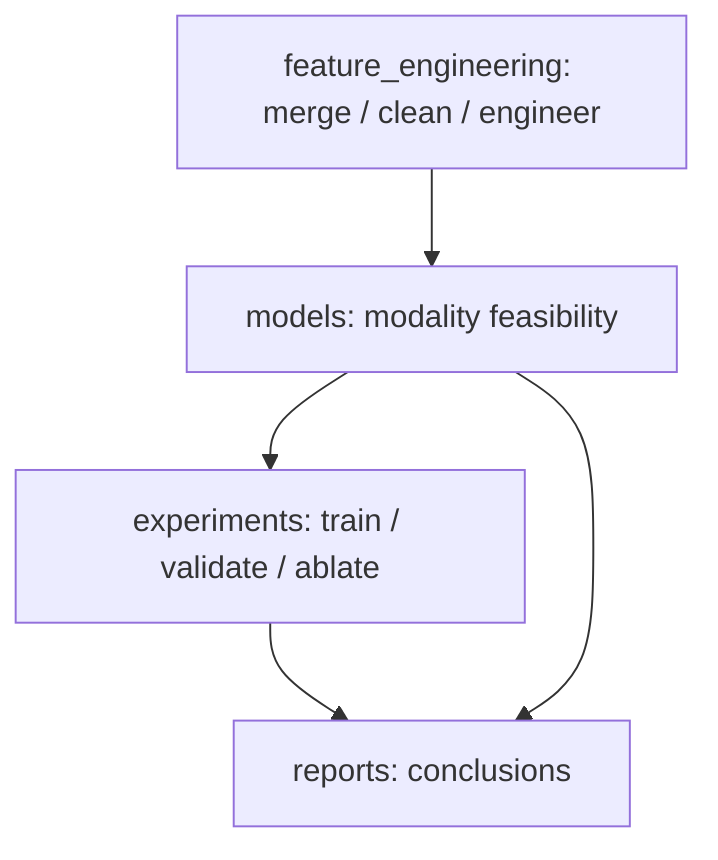

# feature_engineering -> models -> experiments 闭环说明

这个文档由 `run_feature_engineering.py` 生成，解释 feature_engineering 在整个仓库中的位置。

## 角色划分

- `feature_engineering/`：把原始站点表与天气表整理成统一特征表，并输出可复用的统计和报告。
- `models/`：做模态可行性判断，例如 3D vs 2D 是否值得作为默认输入空间。
- `experiments/`：在统一切分和统一指标下验证模型收益，决定哪些模态真的值得保留。
- `reports/`：收束结论与下一步研究建议。

## 逻辑顺序

## 模态判断是软门控

- `reports/3D_vs_2D_Analysis.md` 给出的结论，不是硬停止条件，而是 experiments 的默认输入策略建议。
- 如果 3D 数据只带来更粗的时间分辨率和更少的样本，那么它不应自动升级为 experiments 的默认主分支。
- experiments 仍然可以显式做 1D、2D、3D 或序列融合实验，但应在报告中说明这是有针对性的假设验证，而不是默认结论。

## experiments 里到底用了什么维度

- `run_station05.py` 主要是表格型输入，属于 1D / tabular 风格基线。
- `run_sequence_v2.py`、`run_weather_ablation_v3.py`、`run_weighted_loss_v5.py` 和 `run_routing_v5.py` 都使用 16 步历史序列，模型输入张量本质上是 3D：`[样本数, 时间步, 特征数]`。
- 因此，experiments 不是单纯的“一维/二维/三维数据选择”，而是“先定特征空间，再用序列模型验证”的组合流程。

## 当前建议

1. 先运行 `run_feature_engineering.py` 生成统一的特征表和报告。
2. 再让 `models/` 的模态分析作为 experiments 的默认输入建议。
3. 最后用 `experiments/` 的滚动验证和消融实验确认是否真的有增益。

## 产物

- 特征工程报告: `PVOD_Forecast/reports/station05_feature_analysis_report_2019-04.md`
- 桥接报告: `reports/feature_engineering_pipeline_bridge.md`
- 桥接 manifest: `reports/feature_engineering_pipeline_bridge.json`

