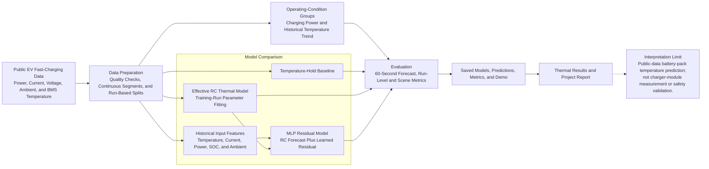

# 充电热预测项目架构

充电热预测是项目的辅助研究主线，使用公开电动汽车快充数据，预测 BMS 报告的电池包最高温度。实验比较温度保持基线、有效 RC 热模型，以及在 RC 预测基础上学习残差的 MLP。该分支作为公开数据上的热预测原型，与 PV 主线共同支撑项目的数字能源研究叙事。

## 架构图

## 研究流程说明

1. **数据准备：** 检查公开快充记录，整理温度、电流、电压、功率和环境变量，并按运行及时间划分训练、验证和测试数据。
2. **模型比较：** 使用温度保持作为短时基线，使用有效 RC 模型表示简化热响应，并由 MLP 学习 RC 模型的预测残差。
3. **误差评估：** 比较未来 60 秒温度预测结果，并按充电功率和历史升温、平稳、降温状态分析误差。
4. **结果归档：** 保存模型、预测、评价指标和演示样例，供最终报告使用。

## 结论适用范围

预测对象是公开车辆数据中的 BMS 电池包最高温度，不是固定测点的温度，也不是 Deye 充电模块或散热器温度。RC 参数属于当前数据和模型假设下的有效拟合参数；实验不构成充电设备热安全或硬件性能验证。
